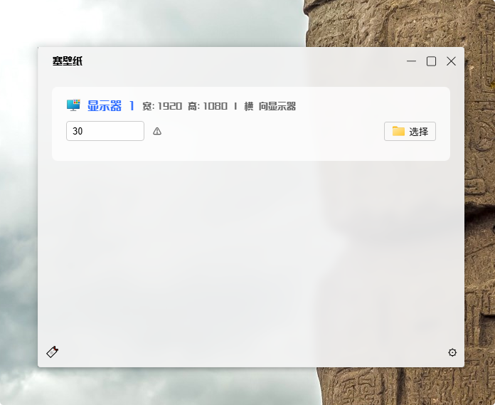

## 项目简介
往你的屏幕上塞一点壁纸； 支持自定义壁纸，支持多屏幕，随机/顺序壁纸；  
开发的目的：  
1. windows自带的壁纸挺好用的，但是不能支持幻灯片模式的时候设置多个目录下的图片，虽然可以把所有的目录合并，但是也太难受了；  
2. 增强壁纸的设置，可以给不同的屏幕设置不同目录下的壁纸，也可以多选目录，在目录中随机挑选一个图片作为壁纸，根据屏幕的横纵比例自动挑选合适比例的壁纸；

## Project Introduction
Put some wallpapers on your screen; supports custom wallpapers, multi-monitor setups, and random/sequential wallpaper switching.

Purpose of development:
1. Windows' built-in wallpaper feature is quite good, but it doesn't support slideshow mode with images from multiple directories. While you could merge all the directories together, that's incredibly annoying.  
2. Enhance wallpaper settings by allowing different directories for different monitors, or select multiple directories and randomly pick an image from them as the wallpaper, automatically selecting appropriately proportioned wallpapers based on each screen's aspect ratio.

### wails v3 , svelte 5
## 开发启动

 ```sh
 wails3 dev
 ```

## 构建项目
 ```sh
 wails3 build
 ```

# 注意事项
> 1.TMD wails 默认的把**cgo** 给关上了，害我找了半天 build/windows/Taskfile.yml 下的**CGO_ENABLED**  
> 2.html背景使用rgba全透明的时候无法使用**backdrop-filter**背景模糊